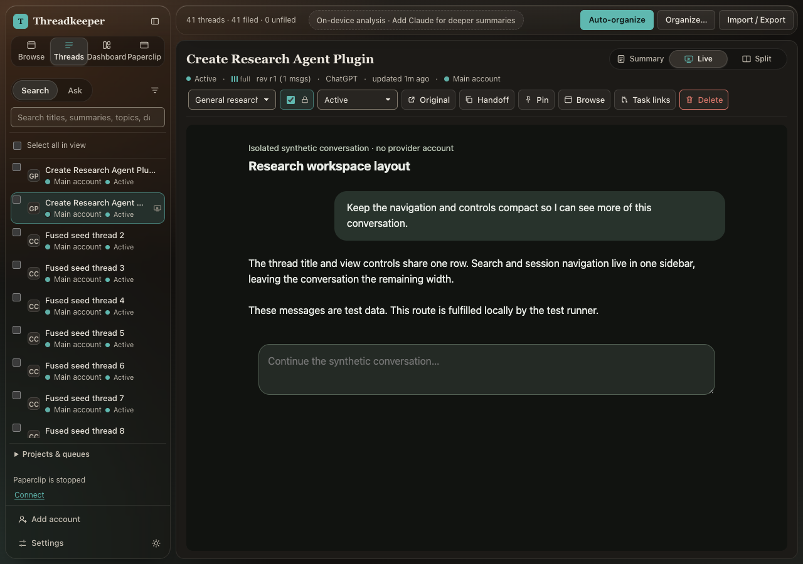

# Threadkeeper repair and compact chat verification

The requested source repairs and interface changes are implemented. The final isolated browser plan passes **32 of 32 journeys**, with **zero failures or evidence gaps**: [Chrome](chrome/report.md) and [Edge](edge/report.md). These are product observations for this repair scope, not completion of every original plan gate.

The thread mode switch sits beside the title. Category, lock, status, actions and Task links share one compact row. Task links open in a native dialog. Search, Ask, filters, sorting, grouping and selection live in the existing Sessions sidebar, leaving the main pane for the conversation. Ask has a full-width multiline field; account names truncate without overlapping.

The standalone header measures about **110 px**, leaving about **680 px** for the live frame at 1280×900. Browser fixtures use a locally served synthetic conversation; no real provider account or key was used. The underlying provider's own header and composer are outside these layout claims.

## Repaired behavior

- Direct Threads entry preserves the requested view through Paperclip's initial home-route and empty-slot messages.
- Mobile host layout gives the real measured slot a bounded height. Fresh 700 px and 480 px entries work without accepting fabricated or zero-sized rectangles.
- Accepted palette closes and validated frame-close messages commit synchronously. A narrow trusted mouse-press handoff preserves session selection while Chromium's old frame still owns hit testing.
- The handoff can select only a connected, registered current-library row. It requires the verified fused Threads host, bounded coordinates, fresh absence of blocking overlays and the original 250 ms close window. Internally owned gesture sequences reject duplicate/older accepted packets while preserving distinct physical presses. No arbitrary DOM, credential, destructive, provider or agent action is invoked.
- Outside-pointer dismissal keeps its original selection. Native task-link dialogs trap the appropriate keyboard shortcuts and return focus on Close/Escape.
- Boot-channel refusal tests and executable cross-package route/timing contracts now cover the earlier test gaps. SDK source pins match the reviewed lock and all 543 committed inputs.

## Supporting checks

| Check | Result and receipt |
|---|---|
| Extension full suite, two workers | **1,957 passed in 106 files**, final source: [log](logs/final-extension-sequence.log) |
| Browser-sessions plugin | **110 passed**, source unchanged by later UI repairs; [test log](logs/plugin-tests.log), [typecheck](logs/plugin-typecheck.log) and [receipt](plugin-contract-receipt.md) |
| Focused UI integration | **151 passed**, followed by the affected host/close/sequence supplements and whole-UI typechecks; [broader log](logs/final-ui-tests.log), [affected log](logs/final-ui-r2.log), [sequence receipt](sequence-implementation.md) |
| Focused server integration | **188 passed in 5 files**, server typecheck clean: [tests](logs/final-server-tests.log), [types](logs/final-server-typecheck.log) |
| Guard, contract and fork-CI tests | **22 passed**: [log](logs/final-contracts-sequence.log) |
| Fork routing/workflow checks | **147 passed** at authoring, valid YAML/shell blocks; [static receipt](fork-ci-static-validation.json), [CI design](../fork-ci-implementation.md) |
| Extension/UI/server/plugin typechecks | Clean for their changed scopes; logs and implementation receipts retained |
| Safe extension build | Passed only into `/tmp/tk-build`; no stable manifest key or live deployment: [build](logs/final-safe-extension-build-sequence.log) |
| Current plugin bundle | Passed TypeScript and UI bundle production build: [log](logs/final-plugin-build.log) |
| Official SDK source-pin check | **543 inputs, unchanged, no runtime-pin change**: [receipt](logs/final-sdk-pins-sequence.log) |
| Plan structure | **39 artifacts, zero errors/warnings**; statuses stay in progress |
| Independent source review | Ordered spec then quality passes, with supplements for later reproduced defects: [reviews](reviews/) |

The first unrestricted extension run had a stale test selector and two five-second timeouts under host load. The selector was corrected; the full bounded-concurrency run then passed. Failed and interrupted attempts are not counted as passes. `pnpm verify --explain` reaches the expected exit 2 because this broad fork change needs wider qualification; it no longer fails the stale SDK-pin guard.

## Browser evidence and lineage

Final Chrome round 43 and Edge round 44 each pass all 16 required journeys. Both use the same frozen app inputs, a disposable extension/profile, an isolated loopback server/database, real native pointer/keyboard actions, screenshots, original recordings and structured receipts. The test-only manifest was restored in both runs. The sealed directories were copied here byte for byte and rechecked: [Chrome validation](chrome-check.json), [Edge validation](edge-check.json).

The marker in the captured extension build names the commit that existed before the final repair commit. [The lead check](lead-integration-check.json) verifies every recorded runtime source hash against the final source, including the subsequently committed sequence repair. A commit or delivery-path change alone does not change those inputs. Served JavaScript/CSS bytes were checked against the frozen UI build.

Earlier rounds remain in `.acceptances/paperclip-merge/`. The original click-only and one-window approaches had real failures. Controlled split-gesture probes demonstrated native down/up in different documents; the final two-press FIFO probe verified ordered delivery and distinct selection. These probes do not establish every older intermittent failure's individual cause. Round 42's outage failure came from an expired owned watcher; the final runs include actual stop/restart recovery. The apparent transparent task dialog and duplicate strip were intermediate animation/compositor captures; settled captures required no product change.

Recordings were sampled with the inspection limits stated in the browser reports. They do not certify the absence of every possible one-frame flash. The evidence checker validates structure and integrity, not pixels or runtime truth.

## Preservation and remaining qualification

The live extension manifest bytes and modification time and the original checkout's Git head remain unchanged. This repair cycle did not write to that checkout or install/register a live helper/service. The old 443-file snapshot has 80 differences from the currently clean tracked original checkout; no historical snapshot-parity pass is claimed for this run. The approved profile snapshot remains in the integration and merged Threadkeeper history. [Preservation details](original-snapshot-preservation.json).

All owned temporary browser, server, PostgreSQL and watcher resources are closed: [cleanup](browser-cleanup.json). No credential values were found in the retained readable browser artifacts: [scan receipt](browser-credential-scan.json).

Hosted fork CI is recorded separately after PR creation. The full Paperclip suite remains unqualified. Native consent, real provider accounts/keys, helper installation, launchd/service registration, MV3 suspension and live-library continuity still require their own evidence. Original wording/start/load/complete gates and recorded founder decisions remain visible in the plan; no TASK/REQ is falsely marked complete.
